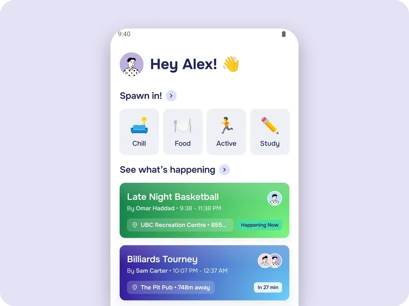
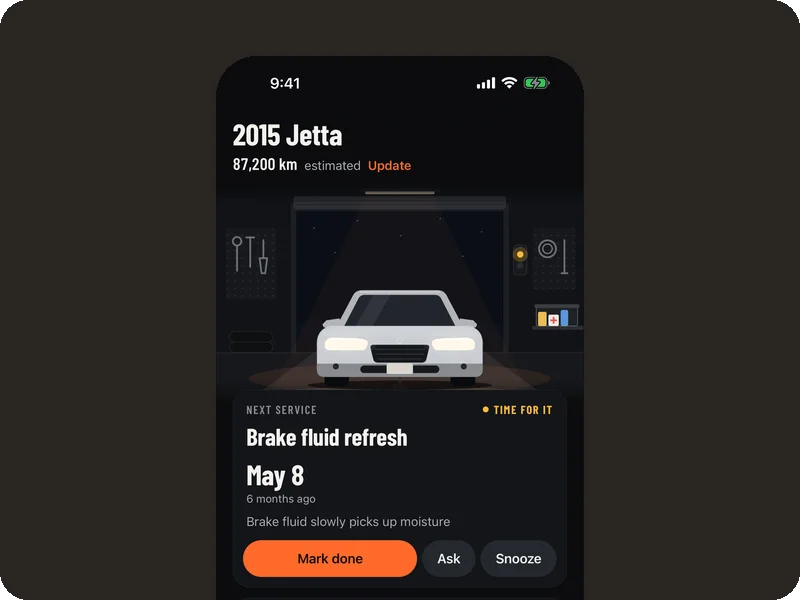
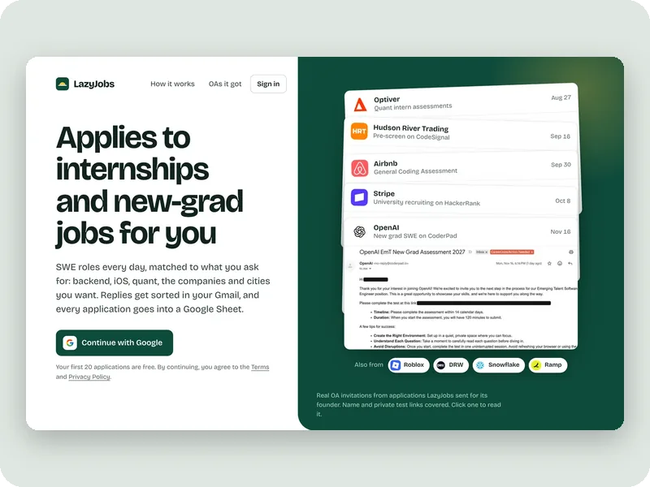

<!-- target="_blank" doesn't appear to work in this markdown language, and neither do rel="external" or onclick="window.open(this.href,'_blank');return false;"!-->

<h2>Hey, welcome to my GitHub portfolio!
    
    
<!--     <a href="https://www.instagram.com/ldh_codeclub/" target="_blank">
       -->
    </a>
</h2>

<!-- 

 -->

 

 
 
 
<!-- Apps: preview cards made from the screenshots on danielagapov.com -->
<h3 align="center">Apps I've built</h3>

<table>
  <tr>
    <td width="50%" valign="top">
      
       <b>Spawn</b>: make plans with friends in a few taps instead of an endless group chat. SwiftUI and Spring Boot.
       <a href="https://apps.apple.com/ca/app/spawn/id6738635871">App Store</a> · <a href="https://getspawn.com">getspawn.com</a> · <a href="https://github.com/Daggerpov/Spawn-App-iOS-SwiftUI">iOS</a> · <a href="https://github.com/Daggerpov/Spawn-App-Back-End">Back end</a>
    </td>
    <td width="50%" valign="top">
      
       <b>Quote Droplet</b>: daily quotes on your home screen through widgets. 5,000+ downloads. SwiftUI and Go.
       <a href="https://apps.apple.com/ca/app/quote-droplet-daily-quotes/id6455084603">App Store</a> · <a href="https://github.com/Daggerpov/Quote-Droplet-iOS">iOS</a> · <a href="https://github.com/Daggerpov/Quote-Droplet-Mac">macOS</a> · <a href="https://github.com/Daggerpov/Quote-Dropper">API</a>
    </td>
  </tr>
  <tr>
    <td width="50%" valign="top">
      
       <b>Car Advisor</b>: a mechanic friend in your pocket that keeps your car's records and tells you what's due. In App Store review.
       <a href="https://testflight.apple.com/join/x3rbh8xw">TestFlight beta</a>
    </td>
    <td width="50%" valign="top">
      
       <b>LazyJobs</b>: applies to SWE internships and new-grad jobs for you, then files the replies so your inbox only shows interviews and OAs.
       <a href="https://lazyjobs.up.railway.app">lazyjobs.up.railway.app</a>
    </td>
  </tr>
</table>

More on <a href="https://www.danielagapov.com">danielagapov.com</a>

  <a href="https://danielagapov.notion.site/learning-software-engineering-5e2294e8ffa342b0bd103aafee808f99?source=copy_link" target="_blank">
      <picture>
    
      </picture>
  </a>

