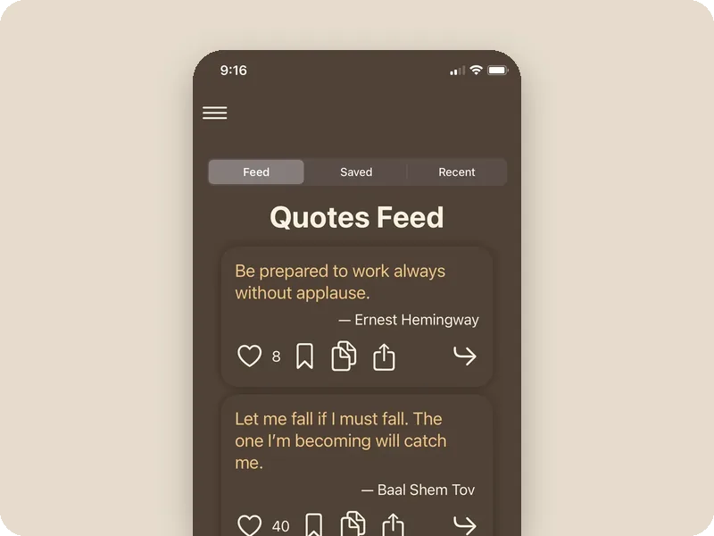

<!-- target="_blank" doesn't appear to work in this markdown language, and neither do rel="external" or onclick="window.open(this.href,'_blank');return false;"!-->

<h2>Hey, welcome to my GitHub portfolio!
    
    
<!--     <a href="https://www.instagram.com/ldh_codeclub/" target="_blank">
       -->
    </a>
</h2>

<!-- Apps: preview cards made from the screenshots on danielagapov.com -->
<h3 align="center">Apps I've built</h3>

<table>
  <tr>
    <td width="50%" valign="top">
      
       <b>Spawn</b>: make plans with friends in a few taps instead of an endless group chat.
           
    </td>
    <td width="50%" valign="top">
      
       <b>Quote Droplet</b>: daily quotes on your home screen through widgets. 5,000+ downloads.
           
    </td>
  </tr>
  <tr>
    <td width="50%" valign="top">
      
       <b>Car Advisor</b>: works out the service schedule for your exact car and tells you what's due next. Snap a receipt or just ask. In App Store review.
        
    </td>
    <td width="50%" valign="top">
      
        <b>LazyJobs</b>: applies to SWE internships and new-grad jobs for you, then files the replies so your inbox only shows interviews and OAs.
        
    </td>
  </tr>
</table>

<h3 align="center">Experience</h3>

<table align="center">
  <tr>
    <td width="56"></td>
    <td><b>Squarepoint Capital</b> Quantitative Developer Intern</td>
    <td align="right">Sep – Dec 2026</td>
  </tr>
  <tr>
    <td width="56"></td>
    <td><b>Amazon</b> Software Development Engineer Intern</td>
    <td align="right">May – Aug 2026</td>
  </tr>
  <tr>
    <td width="56"></td>
    <td><b>Cambio (BGC Engineering)</b> Software Engineer Intern</td>
    <td align="right">May – Dec 2024</td>
  </tr>
  <tr>
    <td width="56"></td>
    <td><b>Ciena</b> Software Engineer Intern</td>
    <td align="right">May – Aug 2023</td>
  </tr>
  <tr>
    <td width="56"></td>
    <td><b>UBC Men’s Mental Health Club</b> Co-President</td>
    <td align="right">2025 – 26</td>
  </tr>
  <tr>
    <td width="56"></td>
    <td><b>University of British Columbia</b> BSc, Computer Science</td>
    <td align="right">2022 – 2027</td>
  </tr>
</table>

  <a href="https://danielagapov.notion.site/learning-software-engineering-5e2294e8ffa342b0bd103aafee808f99?source=copy_link" target="_blank">
      <picture>
    
      </picture>
  </a>

 

<!-- 

 -->

 

 
